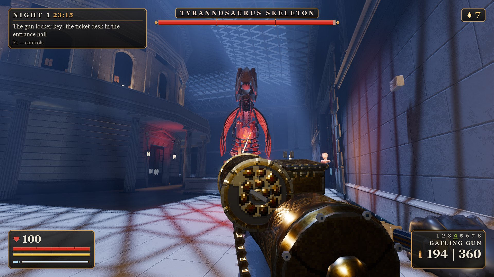
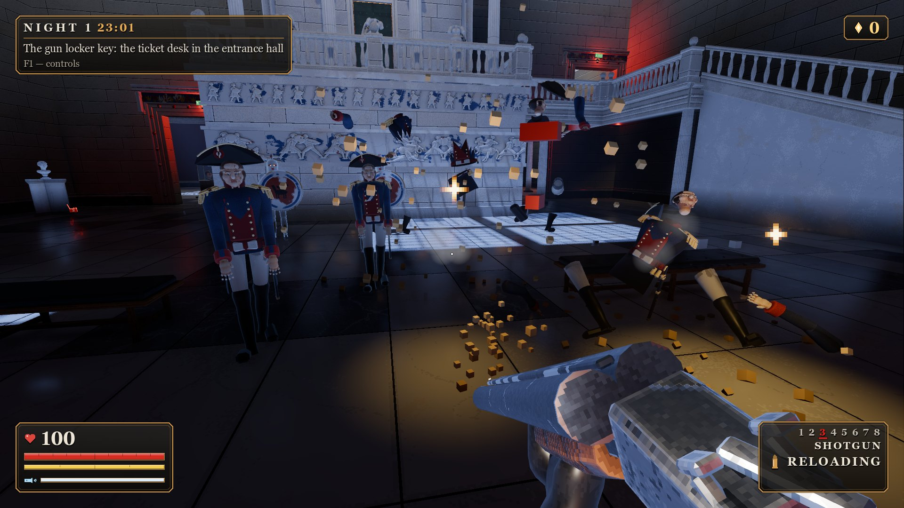
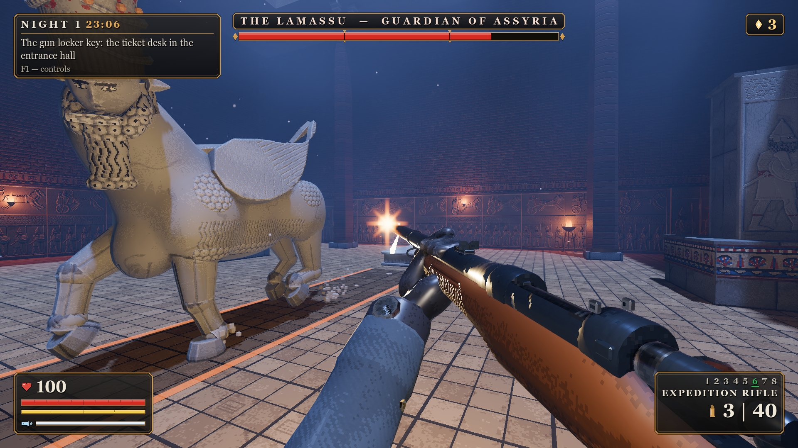
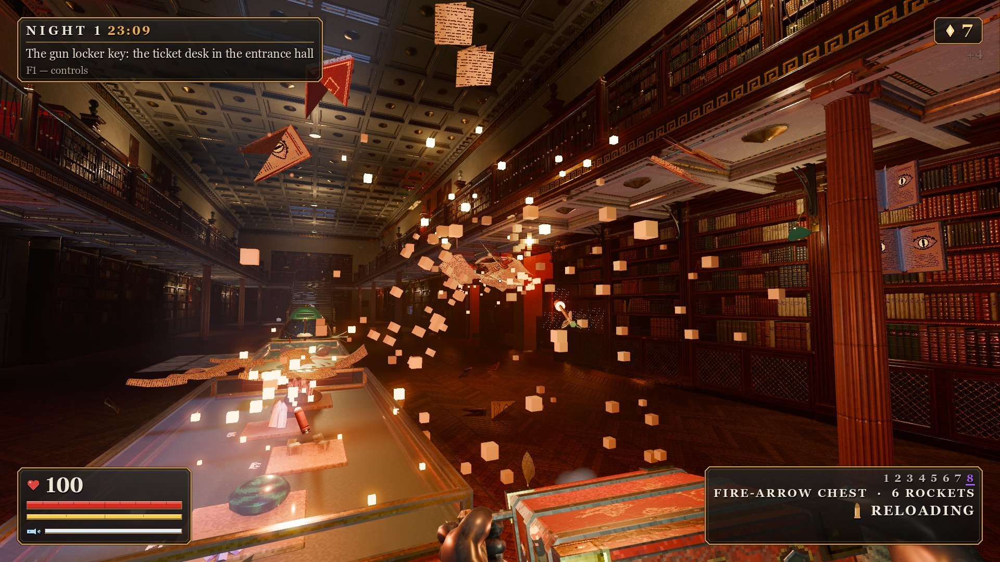
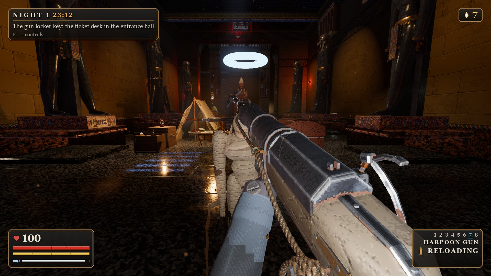
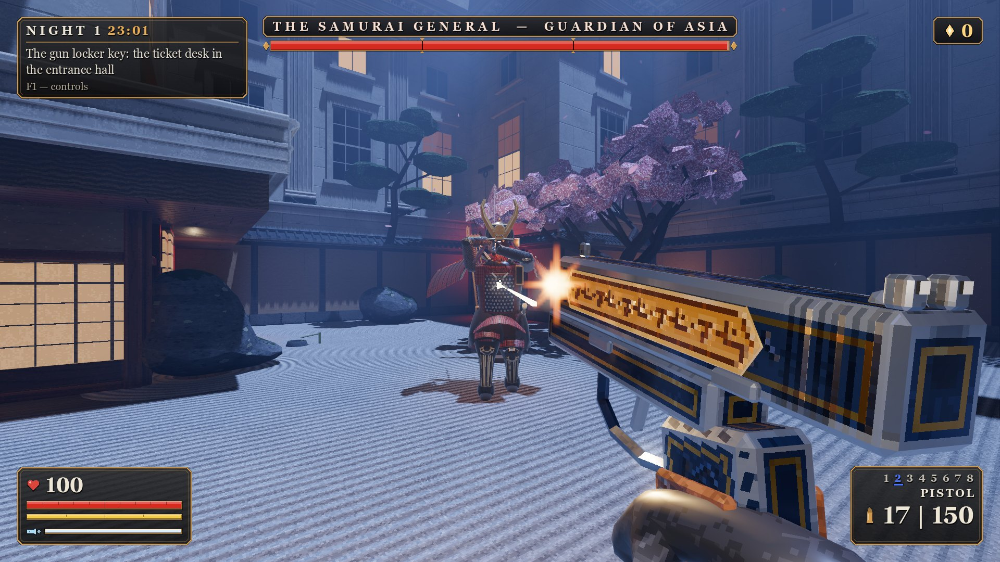
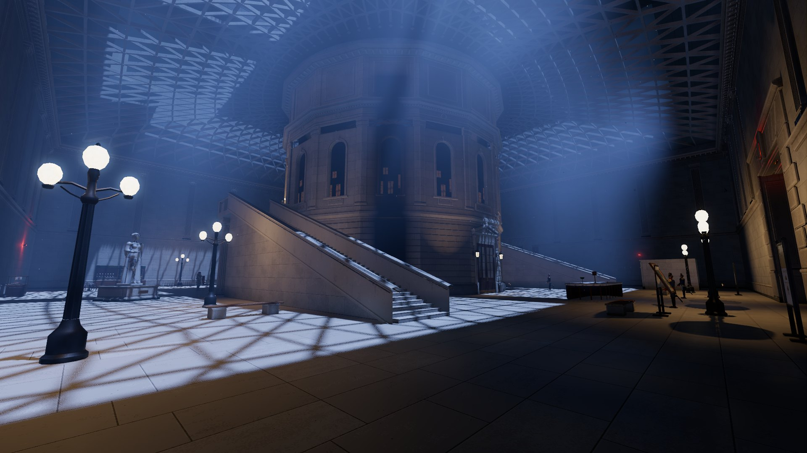

# Nocna Zmiana — *Night Shift*

A first-person **boomer shooter with roguelite progression**, set in a vast museum at night.
You are the night watchman. Every night, from 23:00 to 6:00, the exhibits wake up and come for you —
wax figures, wolves, suits of armour, mummies, flying books, portraits that climb out of their frames,
and a T-Rex skeleton waiting under the glass roof.

Built in **Godot 4.7.2** (GDScript, Jolt physics, Forward+). Every model, texture, sound effect, piece of
music and voice line in the game is generated by scripts in this repository — no third-party asset packs.

> 🇵🇱 Polski opis jest [niżej](#po-polsku).



|  |  |  |
|---|---|---|
| *Shotgun vs wax soldiers* | *The Lamassu, guardian of Assyria, vs the expedition rifle* | *Fire-arrow chest vs flying books, the King's Library* |
|  |  |  |
| *Harpoon gun vs a mummy, Egypt* | *The Samurai General, guardian of Asia* | *The Great Court and the Reading Room* |

*In-game screenshots, 1920×1080, High preset.*

---

## Download and play

Grab the Windows build from **[Releases](../../releases)**, unzip, run `NocnaZmiana.exe`.
No installation. Saves and settings are written next to the executable when that folder is writable,
otherwise to `%APPDATA%\Nocna Zmiana`.

The interface is in **Polish and English** (switch in Options); voice-over is English with subtitles.

## What is in it

- **Floor I** — a grand 19th-century museum floor: a Great Court hub with a glass roof and a round Reading Room,
  six wings (Egypt, Assyria, Greece, the Enlightenment library, Asia, the Americas & Oceania),
  a service basement and the roof. 12 zones, 86+ rooms, opened metroidvania-style over several nights,
  with shortcuts, gates and secrets that persist.
- **Fists and 8 weapons**, each found in the world and kept for good: taser, pistol, shotgun, a crank-driven
  Gatling gun, a flare gun, an expedition rifle that pierces three targets, a harpoon gun that pins and pulls,
  and a Korean *hwacha* fire-arrow chest. Upgrades visibly change the weapon model.
- **Exhibits as enemies** with material-based "gore" (wax melts, marble chips, linen tears, sawdust flies),
  readable telegraphs (every attack announced for at least 0.6 s) and an ecology of their own: combat roles,
  posts and patrol beats, routines when awake, and graded reactions to shots, doors and fallen neighbours —
  without turning the floor into a horde.
- **Gun feel**: a data-driven feel profile per weapon (spring recoil, camera kick that never moves your aim,
  capped screen shake, muzzle flashes, casings), hit reactions by direction and weight, kills that scale with
  the weapon, impact marks per surface.
- **Wing guardians** (mini-bosses) with code-driven rigs and multi-phase fights: the Colossus of Ramesses,
  the Great Orrery, the Centaur from the metope, the Lamassu, the Samurai General, the Two-headed Serpent —
  and the T-Rex as the floor's finale.
- **Roguelite loop**: dust currency you can lose and recover, permanent upgrades, havens, night modifiers,
  a director that rearranges every night, a paper museum map, secrets in three tiers (from a dust pouch to
  unique weapon finishes and weapon mods), and a café in the Great Court where coffee eases a gentle
  fatigue that grows through the night.
- **Music**: each zone has its own band — metal or electronic coloured by its culture (Phrygian dominant
  in Egypt, baroque metal in the library, taiko in Asia, clay flutes and death whistles in the Americas…),
  in four synced layers that follow the fight.
- **Voice-over**: the caretaker Heniek on the walkie-talkie, the museum's own uncanny "System" over the
  loudspeakers and an audio guide at twelve stands — 140 lines generated offline with Kokoro-82M;
  subtitles in the game's language.

### Controls

| Action | Key |
|---|---|
| Move / jump / sprint / dash | W A S D / Space / Shift / Ctrl or mouse side button |
| Fire / punch | Left mouse / V or right mouse |
| Reload | R |
| Flashlight / interact | F / E |
| Weapons | 1–8 or mouse wheel |
| Map / help / fullscreen / pause | M / F1 / F11 / Esc |

Keys follow physical positions, so they work on any keyboard layout.

## Run from source

1. Install **Godot 4.7.2** (standard build, not .NET).
2. Open `project.godot` in the editor and press Play — or, on Windows, put
   `Godot_v4.7.2-stable_win64.exe` and `Godot_v4.7.2-stable_win64_console.exe` into `tools/godot/`
   and double-click `Graj.bat`.

### Tests

The project has its own headless test runner (no external test framework): ~2600 unit and integration
tests — night director determinism, reachability of every objective through every door the director may
lock, whole scripted nights, guardian fights, save compatibility.

```bash
bash tools/run_tests.sh                  # all tests, headless, --fixed-fps 60
bash tools/run_tests.sh --filter=lamassu # a subset
```

The scripts in `tools/` expect Godot in `tools/godot/` (see `tools/dev_env.sh`).

### Export

```bash
bash tools/export.sh   # needs the 4.7.2 Windows export templates in tools/godot/editor_data/export_templates/
```

## How the content is made

Nothing is hand-modelled or downloaded — everything is reproducible from scripts:

| What | How | Where |
|---|---|---|
| 3D models | Python scripts run in **Blender 5.1** in the background (`blender -b -P`), exported to `.glb` with named joints and markers the game animates | `tools/art/` |
| Textures | procedural (marble, limestone, parquet, wallpaper, brass, canvas…) baked to pixel atlases at a fixed texel density | `tools/art/` |
| Animation | code-driven rigs: two-bone IK, springs, motion clips; feet planted in the world | `src/game/floor1/guardians/`, `src/enemies/` |
| Levels | data: rooms, openings, stairs, lights, spawn and loot slots; a shell carver builds watertight geometry from them | `src/level/` |
| Music & ambience | procedural DSP in Python/numpy (per-culture modes for each wing), encoded to Ogg | `tools/music/` |
| Sound effects | synthesised in Python | `tools/sfx/` |
| Voice | Kokoro-82M (ONNX) text-to-speech + own TD-PSOLA processing for the "System" voice | `tools/tts/` |

## Code tour

| Path | Responsibility |
|---|---|
| `src/core`, `src/state` | event bus, input, settings, scene flow, save files and paths; persistent and per-night state |
| `src/player`, `src/weapons`, `src/combat` | the watchman, data-driven weapons, hitscan, projectiles, explosions, hurt zones |
| `src/enemies` | shared exhibit state machine, perception, navigation, crowd; every enemy type; the T-Rex |
| `src/level` | layout data, shell carving, level builder, doors, room graph, lighting, nav tiles; Floor I zones |
| `src/game` | the `Museum` game scene, night director, night goal, clock, modifiers; Floor I guardians |
| `src/progression`, `src/haven` | dust economy, upgrades, night rules, havens |
| `src/audio`, `src/fx`, `src/style`, `src/ui` | music, ambience, reverb zones, voice director; effects; art library and light recipes; menus and HUD |

Design documents (in Polish) live in `docs/`: the full specification `docs/Nocna-Zmiana-specyfikacja.md`,
the Floor I design `docs/superpowers/specs/`, and the step-by-step implementation plans `docs/superpowers/plans/`.

## How it was made

Designed and directed by **vus955**; implemented with **Claude Code** (Anthropic) — AI agents working from
written specs and plans, test-first, each feature on its own branch, reviewed and merged by a coordinating
agent. The commit history shows this process (commits are co-authored by Claude).

## License

Code and all generated content: [MIT](LICENSE). Third-party tools and libraries: see [CREDITS.md](CREDITS.md).

---

## Po polsku

**Nocna Zmiana** to strzelanka FPP w stylu „boomer shooter” z elementami roguelite. Jesteś nocnym stróżem
w wielkim muzeum: co noc, od 23:00 do 6:00, eksponaty budzą się do życia i atakują. Piętro I to hol
z Wielkim Dziedzińcem i sześć skrzydeł (Egipt, Asyria, Grecja, Oświecenie, Azja, Ameryki i Oceania),
podziemia i dach — otwierane krok po kroku przez kilka nocy. 8 broni z własnym „gun feel”, sześciu
strażników skrzydeł, szkielet T-Reksa na finał, eksponaty z rutynami i reakcjami na otoczenie, Pył jako
waluta, trwałe ulepszenia, sekrety w trzech poziomach nagród, kawiarnia i zmęczenie, przystanie,
papierowa mapa muzeum, muzyka metal/elektronika z kolorytem każdej kultury i 140 kwestii głosowych.

- **Zagraj:** pobierz wersję dla Windows z zakładki **Releases**, rozpakuj i uruchom `NocnaZmiana.exe`.
- **Ze źródeł:** Godot 4.7.2 → otwórz `project.godot` i uruchom (albo `Graj.bat` z Godotem w `tools/godot/`).
- **Testy:** `bash tools/run_tests.sh`.
- Interfejs po polsku i angielsku, głos po angielsku z napisami.
- Wszystkie modele, tekstury, muzyka, dźwięki i głosy powstają ze skryptów w tym repozytorium.
- Pełna dokumentacja projektowa (po polsku) jest w katalogu `docs/`.

Licencja: MIT.
