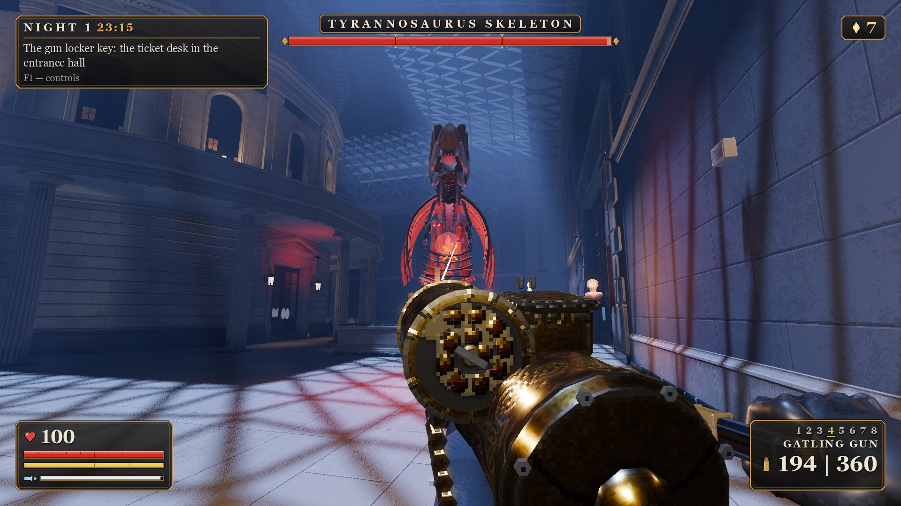
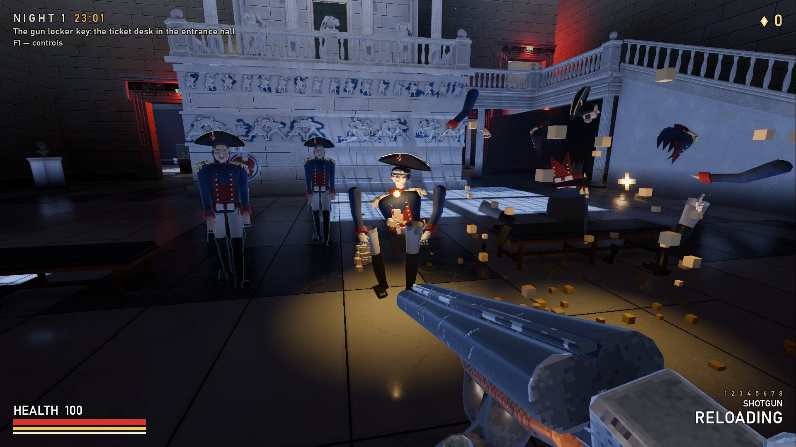
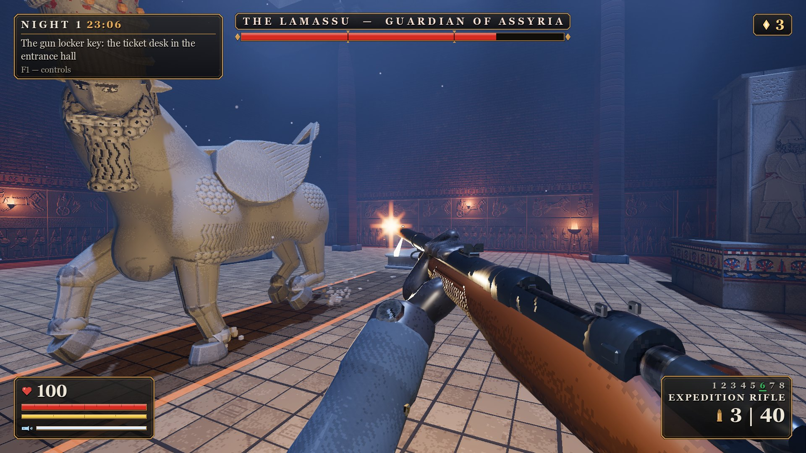
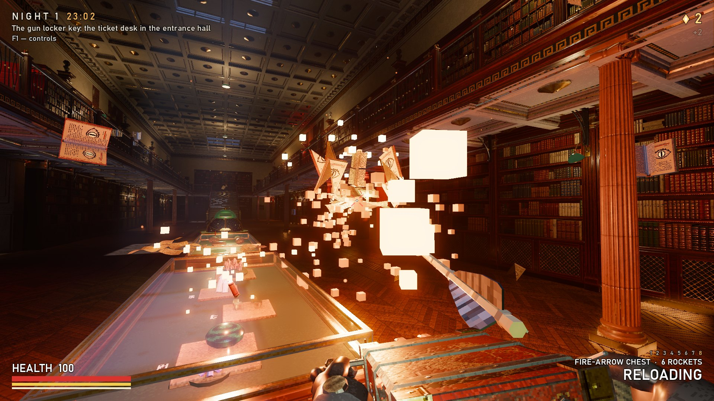
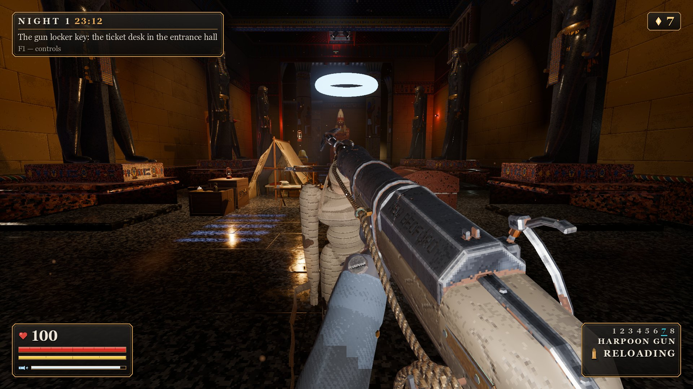
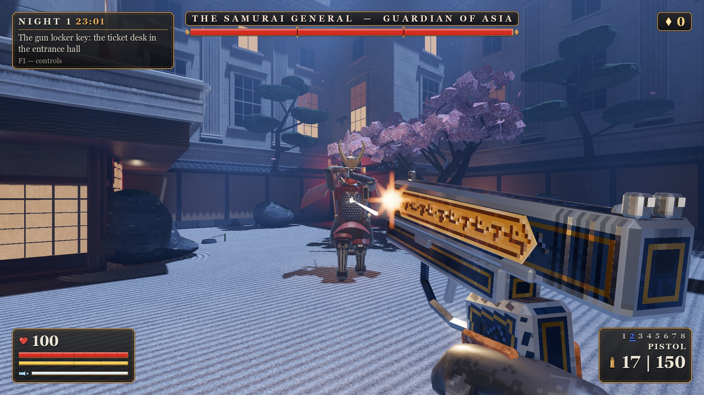
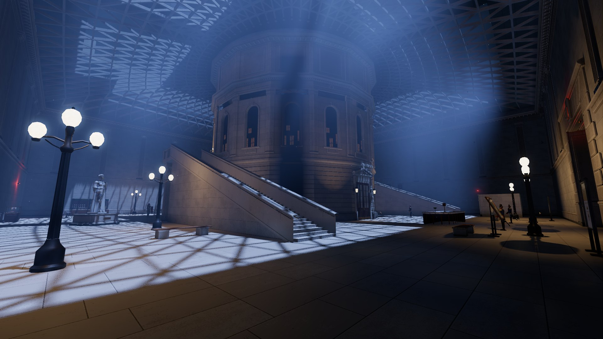

# Nocna Zmiana — *Night Shift*

[](https://github.com/vus955-gif/nocna-zmiana/actions/workflows/tests.yml)

A first-person **boomer shooter with roguelite progression**, set in a vast museum at night.
You are the night watchman. Every night, from 23:00 to 6:00, the exhibits wake up and come for you —
wax figures, wolves, suits of armour, mummies, flying books, portraits that climb out of their frames,
and a T-Rex skeleton waiting under the glass roof.

Built in **Godot 4.7.2** (GDScript, Jolt physics, Forward+). Every model, texture, sound effect, piece of
music and voice line in the game is generated by scripts in this repository — no third-party asset packs.

> 🇵🇱 Polski opis jest [niżej](#po-polsku).



|  |  |  |
|---|---|---|
| *Shotgun vs wax soldiers* | *The Lamassu, guardian of Assyria, vs the expedition rifle* | *Fire-arrow chest vs flying books, the King's Library* |
|  |  |  |
| *Harpoon gun vs a mummy, Egypt* | *The Samurai General, guardian of Asia* | *The Great Court and the Reading Room* |

*In-game screenshots, 1920×1080, High preset.*

---

## Download and play

Grab the Windows build from **[Releases](../../releases)** (a zip of about 475 MB for v0.3.0), unzip,
run `NocnaZmiana.exe`. No installation. It needs **Windows 10/11, 64-bit, and a Vulkan-capable GPU**.
Saves and settings are written next to the executable when that folder is writable,
otherwise to `%APPDATA%\Nocna Zmiana`.

The executable is **not code-signed**, so Windows SmartScreen may stop it the first time
("Windows protected your PC"): *More info* → *Run anyway*. Each release's notes give the SHA-256 of the zip
to check the download against.

The interface is in **Polish and English** (switch in Options); voice-over is English with subtitles.

## What is in it

- **Floor I** — a grand 19th-century museum floor: a Great Court hub with a glass roof and a round Reading Room,
  six wings (Egypt, Assyria, Greece, the Enlightenment library, Asia, the Americas & Oceania),
  a service basement and the roof. 12 zones, 86+ rooms, opened metroidvania-style over several nights,
  with shortcuts, gates and secrets that persist.
- **Fists and 8 weapons**, each found in the world and kept for good: taser, pistol, shotgun, a crank-driven
  Gatling gun, a flare gun, an expedition rifle that pierces three targets, a harpoon gun that pins and pulls,
  and a Korean *hwacha* fire-arrow chest. Upgrades visibly change the weapon model.
- **Exhibits as enemies** with material-based "gore" (wax melts, marble chips, linen tears, sawdust flies),
  readable telegraphs (every attack announced for at least 0.6 s) and an ecology of their own: combat roles,
  posts and patrol beats, routines when awake, and graded reactions to shots, doors and fallen neighbours —
  without turning the floor into a horde.
- **A museum that fights back**: glass cases shatter, lamps swing and fall, busts and statues topple, paintings slip
  and banners tear; seven tagged environmental tools (a chandelier, a storm lamp, a Greek column, a library bookcase,
  a hoisted relief slab, a Korean rocket crate, a stone wheel) can be brought down on the exhibits, each with a fair
  warning. Every wing has a mechanic of its own: curse plates, hunting nets, Helios mirrors, a regulator clock,
  temple bells, sacred fire and totem sight, basement steam.
- **Nights that escalate** in four phases, with hand-made uncanny events, foreshadowed ambushes, rooms that have
  changed when you come back, fights staged as small scenarios (first contact, a turn of events, a flank) and a
  set-piece across the Great Court — *Grandmother's Footsteps* in the dark.
- **A story told by things**: brass exhibit labels with clues, staff vignettes in every wing, curios that answer the
  guard, the café corkboard and the CCTV shift log.
- **Gun feel**: a data-driven feel profile per weapon (spring recoil, camera kick that never moves your aim,
  capped screen shake, muzzle flashes, casings), hit reactions by direction and weight, kills that scale with
  the weapon, impact marks per surface.
- **Wing guardians** (mini-bosses) with code-driven rigs and multi-phase fights: the Colossus of Ramesses,
  the Great Orrery, the Centaur from the metope, the Lamassu, the Samurai General, the Two-headed Serpent —
  and the T-Rex as the floor's finale.
- **Roguelite loop**: dust currency you can lose and recover, permanent upgrades, havens, night modifiers,
  a director that rearranges every night, a paper museum map, secrets in three tiers (from a dust pouch to
  unique weapon finishes and weapon mods), and a café in the Great Court where coffee eases a gentle
  fatigue that grows through the night.
- **Music**: each zone has its own band — metal or electronic coloured by its culture (Phrygian dominant
  in Egypt, baroque metal in the library, taiko in Asia, clay flutes and death whistles in the Americas…),
  in four synced layers that follow the fight.
- **Voice-over**: the caretaker Heniek on the walkie-talkie, the museum's own uncanny "System" over the
  loudspeakers and an audio guide at twelve stands — 144 lines generated offline with Kokoro-82M;
  subtitles in the game's language.
- **Accessibility**: colour-blind palettes (deuteranopia, protanopia, tritanopia) for weapons, ammo, pickups and
  the HUD with shape cues that work without colour, HUD size 75–150 %, subtitle size and backing, reduce flashing,
  toggle sprint, key rebinding.

### Controls

| Action | Key |
|---|---|
| Move / jump / sprint / dash | W A S D / Space / Shift / Ctrl or mouse side button |
| Fire / punch | Left mouse / V or right mouse |
| Reload | R |
| Flashlight / interact | F / E |
| Weapons | 1–8 or mouse wheel |
| Map / help / fullscreen / pause | M / F1 / F11 / Esc |

Keys follow physical positions, so they work on any keyboard layout. Every action has two places and takes
keyboard keys and mouse buttons (the wheel too); rebind them in Options → Keys (a key already used by another
action swaps with it). The F1 help and the on-screen prompts show your own keys.

## Run from source

1. Install **Godot 4.7.2** (standard build, not .NET).
2. Open `project.godot` in the editor and press Play — or, on Windows, put
   `Godot_v4.7.2-stable_win64.exe` and `Godot_v4.7.2-stable_win64_console.exe` into `tools/godot/`
   and double-click `Graj.bat`.

### Tests

The project has its own headless test runner (no external test framework): ~3400 unit and integration
tests — night director determinism, reachability of every objective through every door the director may
lock, whole scripted nights, guardian fights, save compatibility. A headless no-cheat playthrough bot
(`bash tools/run_playthrough.sh 1 2 3`) plays Floor I through the real input actions, night after night,
and writes a report per seed.

```bash
bash tools/run_tests.sh                  # all tests, headless, --fixed-fps 60
bash tools/run_tests.sh --filter=lamassu # a subset
bash tools/run_tests.sh --parallel       # all tests in several Godot processes (about 4x faster)
bash tools/run_tests.sh --quick          # the fast, high-signal subset (what CI runs on main and pull requests)
```

CI (`.github/workflows/tests.yml`, Windows) runs the quick subset on every push to `main` and every pull request,
and the full suite when a version tag (`v*`) is pushed — the gate of a release.

The scripts in `tools/` (Windows, Git Bash) have the engine's path written in:
`tools/godot/Godot_v4.7.2-stable_win64_console.exe`, as in step 2 above. Only `tools/run_tests.sh` takes another
binary, through `GODOT_BIN=/path/to/godot` (that is how CI runs it; off Windows it also finds `godot` on the
`PATH`). `tools/dev_env.sh`, which most of them source, does not look for Godot: it only moves Godot's user
folders (`APPDATA`, `LOCALAPPDATA`) to `tools/godot/editor_data/`.

`F3` in a dev build (or with Options → Developer tools) shows a performance overlay: frame time and graph, CPU time
of the physics tick and of the idle callbacks, renderer CPU/GPU time, draw calls, triangles, lamps and shadows left
on by the room culling, awake exhibits, memory — and, on a second press, the script time of every subsystem.
`bash tools/run_cpu_profile.sh` plays a scripted night headless and writes the same breakdown per tick to
`tests/_out/cpu_profile.json`.

### Export

```bash
bash tools/export.sh   # needs the 4.7.2 Windows export templates in tools/godot/editor_data/export_templates/
```

## How the content is made

Nothing is hand-modelled or downloaded — everything is reproducible from scripts:

| What | How | Where |
|---|---|---|
| 3D models | Python scripts run in **Blender 5.1** in the background (`blender -b -P`), exported to `.glb` with named joints and markers the game animates | `tools/art/` |
| Textures | procedural (marble, limestone, parquet, wallpaper, brass, canvas…) baked to pixel atlases at a fixed texel density | `tools/art/` |
| Animation | code-driven rigs: two-bone IK, springs, motion clips; feet planted in the world | `src/game/floor1/guardians/`, `src/enemies/` |
| Levels | data: rooms, openings, stairs, lights, spawn and loot slots; a shell carver builds watertight geometry from them | `src/level/` |
| Music & ambience | procedural DSP in Python/numpy (per-culture modes for each wing), encoded to Ogg | `tools/music/` |
| Sound effects | synthesised in Python | `tools/sfx/` |
| Voice | Kokoro-82M (ONNX) text-to-speech + own TD-PSOLA processing for the "System" voice | `tools/tts/` |

### Regenerate content

The generated files are committed, so the game runs without any of this. To build them again (Windows, Git Bash,
Godot in `tools/godot/` — the build scripts reimport the project at the end):

| What | Command | Needs |
|---|---|---|
| Textures, models, atlases | `bash tools/art/build_art.sh [model names…]` | Blender 5.1 |
| Music, ambience, footsteps | `bash tools/build_audio.sh` (about an hour; `encode` or `check` runs only the later steps) | Blender 5.1 |
| Sound effects | `python tools/sfx/gen_sfx.py [names…]` (`floor1` for Floor I's set) | Python 3; numpy for `floor1` (Blender's Python has it) |
| Voice: one-time setup | `bash tools/tts/setup.sh /path/to/folder` | `uv`, the Kokoro model (below) |
| Voice lines | `bash tools/tts/build_voice.sh` (changed lines only; `--all` for every line) | the setup, Blender 5.1 |

**Blender 5.1** runs in the background (`blender -b`), and its bundled Python (with numpy) runs the texture and
audio generators. The scripts expect it in `D:/Program Files/Blender Foundation/Blender 5.1/`; point them elsewhere
with `BLENDER` and `BLENDER_PY`:

```bash
export BLENDER="C:/Program Files/Blender Foundation/Blender 5.1/blender.exe"
export BLENDER_PY="C:/Program Files/Blender Foundation/Blender 5.1/5.1/python/bin/python.exe"
bash tools/art/build_art.sh
```

**The voice tools** live in `tools/tts/.venv` (Python 3.11, made with `uv`) and `tools/tts/models/`, both ignored by
git. `setup.sh` does not download the model: it copies it, with a ready Python environment, from a folder you give it,
which needs:
- `.venv-tts/Lib/site-packages/` with `kokoro-onnx`, `onnxruntime`, `espeakng-loader`, `soundfile` and `numpy`;
- `models/model_fp16.onnx` and `models/af_heart.bin` — the Kokoro-82M model and one voice from
  [onnx-community/Kokoro-82M-v1.0-ONNX](https://huggingface.co/onnx-community/Kokoro-82M-v1.0-ONNX)
  (`onnx/model_fp16.onnx`, `voices/af_heart.bin`).

It then fetches the other candidate voices from the same Hugging Face repository (`download_voices.py`).

## Code tour

| Path | Responsibility |
|---|---|
| `src/core`, `src/state` | event bus, input, settings, scene flow, save files and paths; persistent and per-night state |
| `src/player`, `src/weapons`, `src/combat` | the watchman, data-driven weapons, hitscan, projectiles, explosions, hurt zones |
| `src/enemies` | shared exhibit state machine, perception, navigation, crowd; every enemy type; the T-Rex |
| `src/level` | layout data, shell carving, level builder, doors, room graph, lighting, nav tiles; Floor I zones |
| `src/game` | the `Museum` game scene, night director, night goal, clock, modifiers; Floor I guardians |
| `src/progression`, `src/haven` | dust economy, upgrades, night rules, havens |
| `src/audio`, `src/fx`, `src/style`, `src/ui` | music, ambience, reverb zones, voice director; effects; art library and light recipes; menus and HUD |

Design documents (in Polish) live in `docs/`: the full specification `docs/Nocna-Zmiana-specyfikacja.md`,
the Floor I design `docs/superpowers/specs/`, and the step-by-step implementation plans `docs/superpowers/plans/`.

## How it was made

Designed and directed by **vus955**; implemented with **Claude Code** (Anthropic) — AI agents working from
written specs and plans, test-first, each feature on its own branch, reviewed and merged by a coordinating
agent. The public history is squashed into a few snapshot commits (co-authored by Claude), so it does not
show the day-to-day work; the process is documented in the repository itself (in Polish, except the brief):

- `docs/superpowers/specs/` — the design documents the plans were written from;
- `docs/superpowers/plans/` — 71 implementation plans, one per stage or feature, most with their task lists,
  the tests to write first and a "Stan prac" (work status) section kept up to date as the hand-off;
- `tools/agents/brief.md` — the common brief every builder agent worked from: the hard rules, the test-first
  workflow, how branches and the test suite are handled, the quality bar and the report format.

## License

Code and all generated content: [MIT](LICENSE). Third-party tools and libraries: see [CREDITS.md](CREDITS.md).

---

## Po polsku

**Nocna Zmiana** to strzelanka FPP w stylu „boomer shooter” z elementami roguelite. Jesteś nocnym stróżem
w wielkim muzeum: co noc, od 23:00 do 6:00, eksponaty budzą się do życia i atakują. Piętro I to hol
z Wielkim Dziedzińcem i sześć skrzydeł (Egipt, Asyria, Grecja, Oświecenie, Azja, Ameryki i Oceania),
podziemia i dach — otwierane krok po kroku przez kilka nocy. 8 broni z własnym „gun feel”, sześciu
strażników skrzydeł, szkielet T-Reksa na finał, eksponaty z rutynami i reakcjami na otoczenie, Pył jako
waluta, trwałe ulepszenia, sekrety w trzech poziomach nagród, kawiarnia i zmęczenie, przystanie,
papierowa mapa muzeum, muzyka metal/elektronika z kolorytem każdej kultury i 144 kwestie głosowe.
Muzeum reaguje na walkę (gabloty, lampy, posągi, siedem pułapek otoczenia), każde skrzydło ma własną mechanikę,
noc narasta w czterech fazach, a Dziedziniec ma własny „moment” — *Baba Jaga patrzy* w ciemności. Opcje dostępności:
palety dla daltonistów, rozmiar HUD i napisów, ograniczenie błysków, przełączany sprint, zmiana klawiszy.

- **Zagraj:** pobierz wersję dla Windows z zakładki **Releases** (ZIP ok. 475 MB), rozpakuj i uruchom
  `NocnaZmiana.exe`. Wymaga Windows 10/11 64-bit i karty graficznej z obsługą Vulkana. Plik exe nie jest
  podpisany cyfrowo, więc SmartScreen może go za pierwszym razem zatrzymać: *Więcej informacji* → *Uruchom mimo to*.
- **Ze źródeł:** Godot 4.7.2 → otwórz `project.godot` i uruchom (albo `Graj.bat` z Godotem w `tools/godot/`).
- **Testy:** `bash tools/run_tests.sh`.
- Interfejs po polsku i angielsku, głos po angielsku z napisami.
- Wszystkie modele, tekstury, muzyka, dźwięki i głosy powstają ze skryptów w tym repozytorium.
- Pełna dokumentacja projektowa (po polsku) jest w katalogu `docs/`.

Licencja: MIT.
